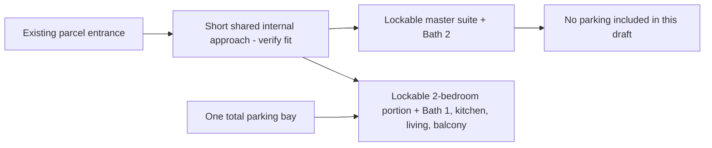

# B operating and quotation brief

16 October2026. Prepared for internal comparison; not an approved architectural plan, contractor quotation, tenancy agreement or instruction to third parties. Latest user instruction controls: **one parking bay per entire B or D parcel**. No two-bay selection exercise remains active.

## Selected working concept

Use the user's master-suite plus two-bedroom expression. The small side need not become a full studio. Do not add a second kitchen simply to justify a studio label. Keep total approved rent1,200+2,000, tenant-paid utilities and final buyer-paid fit-out budget24,975 at gross555,000/nett499,500.

The supplied B plan page26 supports a conceptual internal separation: right master bedroom/Bath2; remaining two bedrooms/Bath1/kitchen/living/dining/balcony. Exact subdivision, door position and clearances are unmeasured and unapproved. The internal common approach must fit within the parcel, not appropriated building common space.

The bay-to-household assignment is an analyst draft, not a new confirmed user preference or authenticated allocation. It matches the likely higher car need of the two-bedroom household. Either allocation can be reconsidered on actual tenant needs without creating another bay or changing the approved rents automatically.

## Requirements to put into a measured design and quote

| Workstream | Required comparison output | Acceptance for this working operation |
|---|---|---|
| Entry and partition | Measured drawing, door swings, partition extent and material, lock/access arrangement | Each tenancy reaches its own rooms/bathroom without crossing the other's private living area; no blocked exit or invented corridor area |
| Acoustic/privacy treatment | Description of door/partition seals, gaps and exposed sight lines | Privacy promise is specific; a lock alone is not assumed acoustic separation |
| Existing bathrooms | Identify access, fittings, defects and any proposed changes | Each side retains one usable bathroom; no unpriced relocation assumed |
| Cooking | Confirm household kitchen and developer inventory; describe small-side offering accurately | Household kitchen is exclusive to household; master suite is offered without a promised private kitchen unless separately designed and costed |
| Laundry | State the actual arrangement for both tenancies | Household laundry must not require master-suite entry, and vice versa; external laundry is a possible master-suite offering, not an automatically included service or proven tenant preference |
| Electrical/water billing | Document safe service access and the workable tenant-billing method | Tenant-paid utilities remain the assumption; no imaginary second utility account, free owner subsidy or inaccessible isolator |
| Cooling and equipment | Identify developer-supplied quantities/locations and buyer top-ups | No double purchase; maintenance access does not depend on entering an unrelated tenant's home without arrangement |
| Furniture/function | Separate necessary inventory for master and household, including storage and work/sleep functions | Fit the measured spaces and actual tenant task; avoid adding decorative spend without a supported benefit |
| Parking | One legal usable bay, one designated tenancy/user and disclosed no-bay counterpart | No same bay promised independently to both parties; no paid second bay or separate parking income |
| Permission and completion | Applicable approvals, permitted works, completion scope and defects responsibility | Do not equate a concept drawing with permitted execution; no approval or contractor appointment is claimed |

No precise partition dimensions, labour prices or fit-out line-item costs are fabricated. A measured design/quote must fill those fields. The existing supplied plan contains area inconsistencies relative to the price file; it is a conceptual reference, not a construction measurement.

## Budget reconciliation sheet

Approved final buyer-paid budget at current base price: **RM24,975**. The developer equipment package is not extra cash available to spend and is not charged twice.

| Quote line | Amount | Treatment |
|---|---|---|
| Partition, door, locks and acoustic treatment | Unquoted | Must be inside approved total |
| Electrical/service allocation and approved necessary works | Unquoted | Must be inside approved total; identify actual scope first |
| Required cooling/equipment not supplied | Unquoted | Net of specific developer-supplied inventory |
| Household/master furniture and practical storage | Unquoted | Separate each tenancy's inventory |
| Curtains, lighting and other actual fit-out scope | Unquoted | Include only buyer-paid requirement |
| Labour, transport, installation, applicable invoice taxes | Unquoted | Include once, not hidden extras |
| Refundable works deposit, if required | Unknown | Separate cash-timing liability from final fit-out expense; not automatically consumed |
| Final non-refundable buyer-paid total | Unquoted | Compare against24,975; do not label an unquoted budget a market quotation |

The RM10k stress remains a sensitivity; it is not approved additional base spending. If a real quote exceeds the budget, show the difference and reprice the operation. Do not quietly inflate the budget to obtain physical feasibility.

## D counterpart under the same parking instruction

D retains1,500+1,500 and one bay total. Designate the bay to one tenancy only; the other is no-bay unless a different agreed shared-use arrangement actually works. Equal rent does not prove equal amenities or identical willingness to pay. No parking premium/discount is inserted without a user change or relevant evidence.

## Evidence boundary and handoff

This brief is ready to compare against a proposed measured design and quotation. Neither has been obtained in this pass. There was no contractor/developer/bank contact, site visit, paid access or booking. Do not report those activities as complete. Future work should close these specific evidence fields, not repeat broad portal searches or ask the Senior Market Red Team to restate approved rents.

Source: supplied Brightwood saleskit page26, SHA256313c53da9961bd91b6d0118352d5d17310dece2c2529c096b4feb47f86b76010, visually reviewed in the prior execution check; [prior plan/source review](../2026-10-16-brightwood-b-execution-check/Execution_and_Evidence.md).
